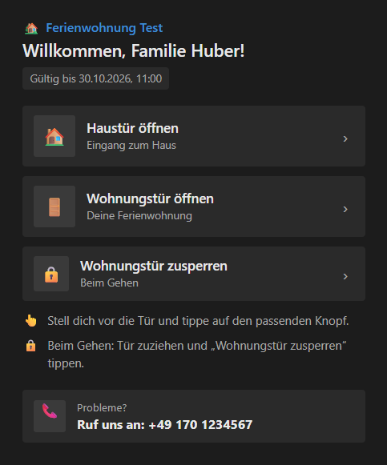
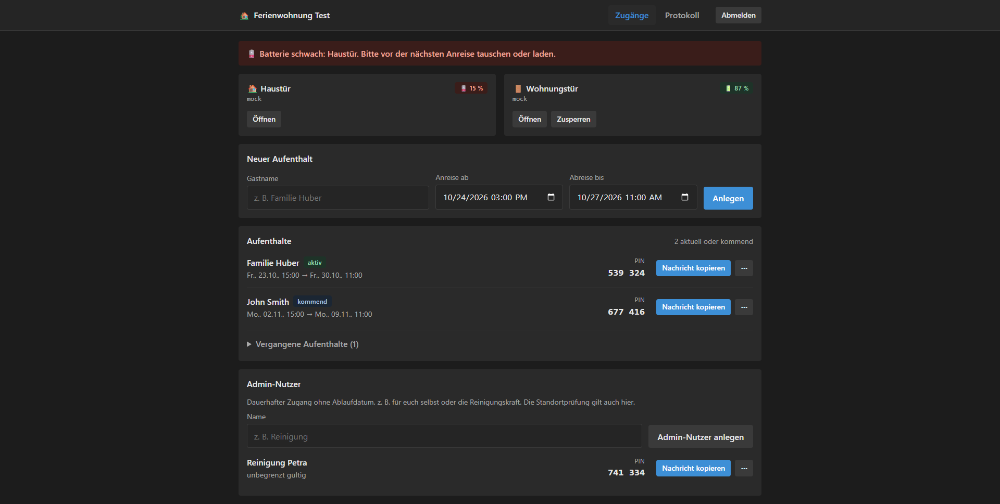

# Guest Opener

Zeitlich begrenzter Zugang für Gäste, als [Home-Assistant-Add-on](https://www.home-assistant.io/docs/apps/).
Jede Person bekommt einen Link und einen PIN und öffnet damit vor Ort Haustür und Wohnungstür vom
Handy aus. Nach der Abreise gilt der Zugang nicht mehr.

Die Türen sind beliebige Home-Assistant-Entitäten. Name, Koordinaten, Telefonnummer und die
öffentliche Adresse stehen nur in der Konfiguration des Add-ons, nicht in diesem Repository.





Die Bilder zeigen Beispieldaten aus einer lokalen Testumgebung.

## Funktionen

- Link und sechsstelliger PIN, gültig nur zwischen Anreise und Abreise
- Haustür öffnen, Wohnungstür öffnen und, bei einem Schloss, wieder zusperren
- Standortprüfung mit einstellbarem Radius, abschaltbar
- Deutsch und Englisch, festes dunkles Design
- Verwaltung für Aufenthalte, dauerhafte Admin-Nutzer, Batteriewarnung und Protokoll
- Push-Nachrichten über einen Home-Assistant-Dienst `notify.*`
- SQLite im Add-on-Ordner, enthalten in den Home-Assistant-Backups

## Installation

Home Assistant mit Supervisor (Home Assistant OS oder Supervised):

1. Einstellungen → Add-ons → Add-on-Store → ⋮ → **Repositories**
2. `https://github.com/reiphi/guest-opener` eintragen
3. **Guest Opener** installieren, konfigurieren und starten

Einrichtung, alle Optionen, der Weg nach außen und die Grenzen der Standortprüfung stehen in
[`guest_opener/DOCS.md`](guest_opener/DOCS.md). Dieselbe Datei zeigt Home Assistant im Reiter
Dokumentation. Die kurze Vorstellung für den Add-on-Store ist
[`guest_opener/README.md`](guest_opener/README.md).

## Sicherheit

Der eigentliche Schutz ist die Kombination aus Link und PIN im Zeitfenster des Aufenthalts.
Die Standortprüfung verhindert Versehen. Sie ist kein Schutz gegen jemanden, der Link und PIN
hat und die Koordinaten selbst schickt. Details und die empfohlenen Maßnahmen stehen in
[`guest_opener/DOCS.md`](guest_opener/DOCS.md#sicherheit).

## Entwicklung

TypeScript, [Hono](https://hono.dev), SQLite über das in Node 24 eingebaute `node:sqlite`.
Das Add-on folgt dem [Aufbau eines Home-Assistant-Add-on-Repositories](https://contributors.home-assistant.io/apps/reference/files/):
`repository.yaml` im Wurzelverzeichnis, das Add-on im Ordner `guest_opener/` mit `config.yaml`,
`Dockerfile`, `README.md`, `DOCS.md` und `CHANGELOG.md`.

```
guest_opener/
  config.yaml         Optionen, Architektur, Zugriff auf die Home-Assistant-API
  Dockerfile          baut ein einzelnes JS-Bundle und packt es in node:24-alpine
  README.md           Kurztext für den Add-on-Store
  DOCS.md             Anleitung im Reiter Dokumentation
  CHANGELOG.md        Änderungen je Version
  translations/       Beschriftung der Optionen, Deutsch und Englisch
  src/                Server, Routen, Türen, SQLite, Seiten
  test/               Tests mit node:test
```

Node 24:

```powershell
cd guest_opener
npm install
copy .env.example .env
npm run dev
npm test
npm run typecheck
```

`npm run dev` simuliert beide Türen (`mock`) und schaltet die Standortprüfung ab. Das
Admin-Passwort steht in `.env`. Echte Geräte brauchen `HA_URL`, `HA_TOKEN` und die Entitäts-IDs.

Das Image benutzt `node:24-alpine` direkt. Es verlässt sich nicht auf das von Home Assistant
früher automatisch gesetzte `BUILD_FROM`.

Nach einer Änderung, die Home Assistant als Update anbieten soll, die Version in
`guest_opener/config.yaml` und `guest_opener/package.json` anheben und `CHANGELOG.md` ergänzen.

## Lizenz

[MIT](LICENSE)
